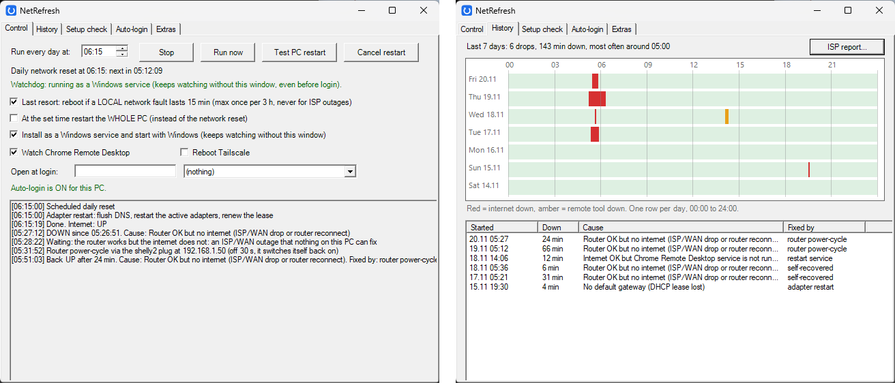

# NetRefresh

A small Windows tool for a PC you need to reach remotely while you are away. It watches the connection, works out **where** it broke, repairs only what can actually be repaired from that PC, records every outage with its cause, and helps you fix the setting that caused it.

## What it does

- **Watchdog as a Windows service.** Checks every 10 s: internet (ping, and a TCP connection to port 443 for networks that block ping), your DNS server asked directly, and optionally Chrome Remote Desktop or Tailscale. It runs without anyone logged in and Windows restarts it if it stops. The window is only the front end; it can also run the watchdog itself if you do not install the service.
- **Repairs chosen by cause.** An outage starts after 3 failed checks in a row (~30 s). Then:

  | Cause found | at 90 s | at 5 min | at 15 min |
  |---|---|---|---|
  | Link down / no gateway (this PC) | restart adapters | restart adapter devices | reboot* |
  | Router not answering | restart adapters | power-cycle router (smart plug) | reboot* |
  | Router fine, no internet (ISP) | nothing (waits, logs) | power-cycle router (smart plug) | nothing |
  | DNS failing | flush DNS | renew lease | nothing |
  | Remote tool stopped | restart it | restart it | nothing |

  \*optional, at most once per 3 h. The cause is checked again at each step. The old "reset everything, then reboot" approach would wipe network settings and reboot every few hours during an ISP outage; this does not.
- **Router power-cycle through a smart plug** (Shelly Gen1, Shelly Gen2+, Tasmota, local HTTP). The plug is told to switch itself back on after 30 s, so the router returns even if the PC cannot reach the plug any more. At most 3 times a day, 30 min apart.
- **Setup check.** Finds the usual causes of overnight drops and fixes them with one click: the adapter "allow the computer to turn off this device" option, energy-saving link features (EEE, Green Ethernet, power saving mode), sleep and hibernate on mains power, Chrome Remote Desktop not starting with Windows, the service not being installed. It also spots a **daily drop pattern** (typical of an ISP's forced 24-hour reconnect) and tells you what to change on the router.
- **History.** `outages.csv`, a log, a 7-day graph and a list. **ISP report** button: a text report of the outages that happened while your router was working, with times and minutes, to send to your provider.
- **Alerts.** Phone alerts through [ntfy.sh](https://ntfy.sh), and a **heartbeat** to [healthchecks.io](https://healthchecks.io) (or a self-hosted copy) every 5 min, which alerts you when the PC stops checking in: power cut, crash, app closed, internet gone.
- **Daily action** at a time you choose: a network reset or a full restart.
- **Come back after a restart:** start with Windows, open a chosen app (searchable list), optional auto-login (see below).
- **Extras:** keep the PC awake, pause Windows Update restarts for 7 days (switches itself off), tray icon with pop-ups, test-restart button, and a manual **Deep reset** (Winsock + TCP/IP, never automatic because it loses static IPs).

## Install

Needs Windows 10/11 and nothing else; the C# compiler that ships with Windows is used.

1. Run `build.bat`. It embeds `NetRefresh.ps1` into `NetRefresh.exe`.
2. Run `NetRefresh.exe` and accept the admin prompt.
3. Tick **Install as a Windows service**. This copies the program to `C:\Program Files\NetRefresh`, installs the `NetRefresh` service, adds a Start-menu entry and opens the window at login. You can delete the downloaded folder afterwards.
4. Open the **Setup check** tab, press **Check now**, fix what it finds.

Untick the box to uninstall the service (your history is kept). Want to look first? `powershell -File NetRefresh.ps1 -Preview` opens the window without admin rights and without touching anything real.

The exe is built locally and unsigned, so SmartScreen or antivirus may warn about a downloaded copy; that is why this repo ships source and a build script instead of a binary.

## Security notes

- The service runs as LocalSystem because repairing the network needs it. It opens **no network ports**; it only makes outgoing requests (ping, DNS, the ntfy/heartbeat/plug URLs you set).
- The program runs from `C:\Program Files\NetRefresh` and keeps its data in `C:\ProgramData\NetRefresh`; only administrators can change either, so no normal program can swap what runs elevated.
- Settings are re-checked when loaded (topic, time, plug address), so a hand-edited file cannot inject anything.

## Auto-login: read this

Auto-login is only needed if you want apps (like a remote-support app) open after a restart; **the watchdog service does not need it**.

- The password is checked once against Windows, then stored the way Sysinternals Autologon stores it: as an encrypted LSA secret. NetRefresh never writes it to its own files or the log, and the box is cleared afterwards.
- It also turns off "Windows Hello only" sign-in, which Windows needs for auto-login.
- Anyone with physical access to the PC can then sign in without a password, and an administrator on the PC can read the stored password with tools. Use **Disable** when you no longer need it.
- Use your account password. For a Microsoft account that is the Microsoft account password, not the PIN.

## Tests

`powershell -ExecutionPolicy Bypass -File tests\Test-Core.ps1` runs the repair logic with fake time and fake repairs (no admin, changes nothing). The Linux version has its own tests in `linux/`.

## Limits

- Windows only (see `linux/` for servers). Cannot help if the PC is off: set the BIOS to power on after a power cut.
- A frozen router needs the smart plug; nothing on the PC can restart it.

## Linux servers

The [`linux/`](linux) folder holds a separate, headless version for Linux servers (Python and systemd, no window). It does not depend on anything above: **delete the `linux/` folder if you don't need it.**

## License

MIT, see `LICENSE`.
